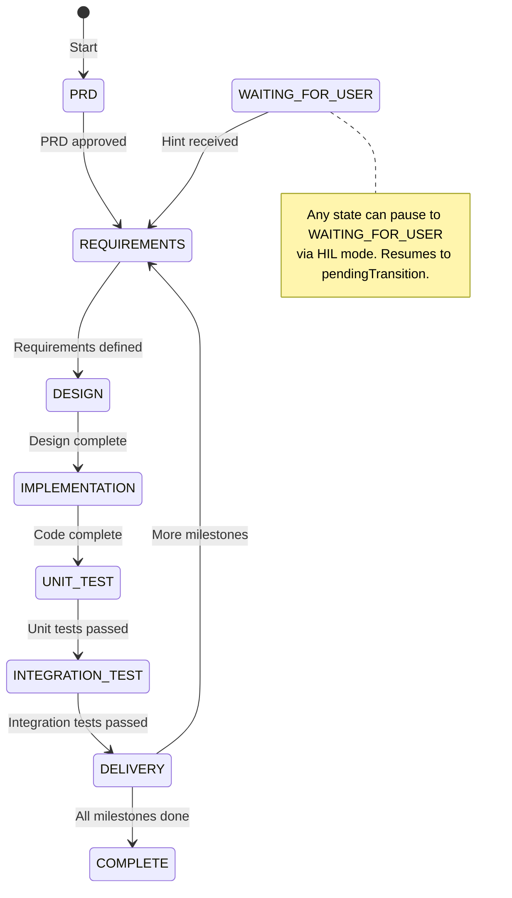

# V-Model Protocol Specification

**Formal specification of the milestone-based V-Model development lifecycle for autonomous R&D agents.**

**Audience**: AI agents, developers implementing V-Model systems

**For user-facing documentation**, see [USER_GUIDE.md](USER_GUIDE.md).

---

## 1. Protocol Overview

The V-Model protocol defines a formal development lifecycle for autonomous R&D agents. It combines:

- **Milestone-driven decomposition**: Goals are broken into independently deliverable milestones
- **Formal V-Model lifecycle**: Each milestone runs through a linear verification chain (Requirements → Design → Implementation → Verification → Delivery)
- **Optional sub-agent review**: Specialist reviewers can evaluate each phase's output
- **Human-in-the-loop control**: Milestones can pause for human approval between phases
- **Git checkpointing**: Auto-commit after each state transition
- **Delivery context injection**: Later milestones receive context from earlier ones

### 1.1 State Machine

The protocol implements a state machine with 9 states:



**State Handler Architecture**: All phases use a single `runAIWithPrompt()` call with phase-specific prompt templates from `src/prompts/states/`. The orchestrator in `src/milestone-loop.ts` manages the loop — no dedicated code handlers per phase.

### 1.2 State Definitions

| State | Type | Description | Progress |
|:------|:-----|:------------|:---------|
| `PRD` | Init | Generate lean PRD with tech stack, architecture, milestone table (one-shot) | 0% |
| `REQUIREMENTS` | Design | Formalize testable requirements for the current milestone | 10% |
| `DESIGN` | Design | Technical design and natural-language test specifications | 25% |
| `IMPLEMENTATION` | Build | Code the milestone against the approved design | 50% |
| `UNIT_TEST` | Verify | Verify module-level logic against test specifications | 70% |
| `INTEGRATION_TEST` | Verify | Verify cross-component behavior and regressions | 85% |
| `DELIVERY` | Delivery | Finalize local branch delivery, finalize documentation, cache delivery summary | 95% |
| `COMPLETE` | Terminal | Milestone done; orchestrator advances to next milestone | 100% |
| `WAITING_FOR_USER` | Control | Paused for human input; stores `pendingTransition` | — |

---

## 2. Transition Rules

Transitions are strictly linear with no backward paths. The hardcoded transition map:

| Current State | Next State |
|:--------------|:-----------|
| `PRD` | `REQUIREMENTS` |
| `REQUIREMENTS` | `DESIGN` |
| `DESIGN` | `IMPLEMENTATION` |
| `IMPLEMENTATION` | `UNIT_TEST` |
| `UNIT_TEST` | `INTEGRATION_TEST` |
| `INTEGRATION_TEST` | `DELIVERY` |
| `DELIVERY` | `null` (orchestrator decides: next milestone or `COMPLETE`) |
| `COMPLETE` | `null` (terminal) |
| `WAITING_FOR_USER` | `null` (resumed via `continue` command) |

### 2.1 WAITING_FOR_USER Mechanics

When HIL mode is active, the orchestrator stores the next intended state in `pendingTransition` before pausing. The `continue` command reads this value, applies it, and re-enters the state loop.

### 2.2 DELIVERY Decision Point

`DELIVERY` maps to `null` in the transition map. The orchestrator checks whether all milestones in the PRD are complete:
- If more milestones remain: advances to the next milestone's `REQUIREMENTS` state
- If all milestones complete: sets project status to done

---

## 3. Milestone Lifecycle Phases

### 3.1 PRD

**Purpose**: Generate a lean Product Requirements Document from a user goal.

**Protocol**:
1. Detect tech stack from existing project files (package.json, Cargo.toml, CMakeLists.txt, etc.)
2. Write a concise Architecture Overview (3-5 sentences)
3. Decompose the goal into milestones (plain integer IDs: 1, 2, 3...)
4. Each milestone must be independently deliverable and produce a testable increment
5. Write `vibe-model/prd.md` with sections: Goal, Tech Stack, Architecture Overview, Milestones table

**One-shot**: Runs exactly once per project. Creates a temporary milestone file with sentinel ID 0, runs AI, then cleans up.

**Output**: `vibe-model/prd.md` with milestones table (columns: ID | Name | Description | Status | Mode)

**Transition**: PRD → PRD review loop → REQUIREMENTS

### 3.2 REQUIREMENTS

**Purpose**: Gather and formalize testable requirements for the current milestone.

**Protocol**:
1. Research: web search, codebase exploration, memory.md consultation
2. Document findings in Research Notes section
3. Write clear, numbered requirements (R1, R2, R3...) in Requirements section
4. Each requirement must be a single verifiable statement — no ambiguous language

**Context Injected**: Status + Requirements + Research Notes

**Transition**: REQUIREMENTS → DESIGN

### 3.3 DESIGN

**Purpose**: Create technical design and natural-language test specifications.

**Protocol**:
1. Research if needed (architectural patterns, existing APIs, conventions)
2. Write Design section: components, data structures, interfaces, tradeoffs
3. Reference specific requirements by number (R1, R2, ...) for each design element
4. Write Test Specifications section using format: **TS-N**: Description → Given [context], When [action], Then [expected result]
5. Test specs are natural language — no code, no framework specifics

**Context Injected**: Status + Requirements + Design + Research Notes

**Transition**: DESIGN → IMPLEMENTATION

### 3.4 IMPLEMENTATION

**Purpose**: Code the milestone against the approved design.

**Protocol**:
1. Review Design and Test Specifications
2. Implement code following the approved design exactly
3. Write unit tests that map to Test Specifications (comment each test with `// Satisfies TS-N`)
4. Run build (mandatory) — must compile with zero errors
5. Run unit tests — must pass
6. Document in Implementation Notes: files created/modified, deviations, limitations

**Context Injected**: Status + Design + Test Specifications

**Transition**: IMPLEMENTATION → UNIT_TEST

### 3.5 UNIT_TEST

**Purpose**: Verify module-level logic against test specifications.

**Protocol**:
1. Run build (mandatory) — zero errors
2. Run unit tests
3. Build traceability matrix: TS-N → Test Name → Pass/Fail
4. Fix failures: distinguish test bugs from implementation bugs from design issues
5. Re-run full suite after each fix
6. Document results in Unit Test Results section

**Context Injected**: Status + Implementation Notes + Test Specifications

**Transition**: UNIT_TEST → INTEGRATION_TEST

### 3.6 INTEGRATION_TEST

**Purpose**: Verify cross-component behavior and regressions.

**Protocol**:
1. Run build (mandatory) — zero errors
2. Run full test suite (not just affected tests)
3. Verify interfaces between modules
4. Check for regressions in existing functionality
5. Fix failures — distinguish integration issues from regressions
6. Document results in Integration Test Results section

**Context Injected**: Status + Design + Unit Test Results

**Transition**: INTEGRATION_TEST → DELIVERY

### 3.7 DELIVERY

**Purpose**: Finalize milestone delivery locally on the current branch and document it.

**Protocol**:
1. Run final build — zero errors and zero warnings
2. Run full test suite — all tests pass
3. Verify all requirements satisfied (trace R-N to implementation)
4. Verify all test specifications passed (trace TS-N to test results)
5. Finalize locally on the current branch — no push, publishing, or PR creation by default
6. Update Delivery section: local branch/commit summary, key deliverables, caveats
7. Update Learnings section: notable findings, patterns to reuse, pitfalls

**Context Injected**: All sections (full summary)

**Transition**: DELIVERY → COMPLETE (orchestrator handles next milestone)

---

## 4. Data Structures

### 4.1 PRD File Format

**Path**: `{PROJ_ROOT}/vibe-model/prd.md`

```markdown
# PRD: {goal title}

## Goal
{goal}

## Tech Stack
{language, framework, build tool, test runner}

## Architecture Overview
{3-5 sentence summary of major components and their interactions}

## Milestones

| ID | Name | Description | Status | Mode |
|----|------|-------------|--------|------|
| 1  | {name} | {description} | PENDING | |
| 2  | {name} | {description} | PENDING | |
```

- **ID**: Plain integers (1, 2, 3...) — no prefixes
- **Status**: `PENDING` | `IN_PROGRESS` | `COMPLETE`
- **Mode**: Optional override — `hil` | `autonomous` | (empty = project default)

### 4.2 Milestone File Format

**Path**: `{PROJ_ROOT}/vibe-model/milestones/{NN}-{name}.md`
- NN: zero-padded ID (01, 02, ...)
- name: lowercase, hyphens, max 64 chars

```markdown
# Milestone {id}: {name}

## Status
- State: {MilestoneState}
- Progress: {percentage}%
- Started: {ISO timestamp}
- Pending Transition: NONE | {MilestoneState}

## Requirements
*(Numbered, testable requirements: R1, R2, R3...)*

## Design
*(Technical design tracing to requirements)*

## Test Specifications
*(Natural-language test cases: TS-N format)*

## Research Notes
*(Findings from research phase)*

## Implementation Notes
*(Files modified, deviations, limitations)*

## Unit Test Results
*(Traceability matrix: TS-N → Test → Pass/Fail)*

## Integration Test Results
*(Cross-component verification, regressions)*

## Delivery
*(Local branch/commit summary, deliverables, caveats)*

## Learnings
*(Findings, patterns, pitfalls)*
```

### 4.3 Delivery Summary Format

**Path**: `{PROJ_ROOT}/vibe-model/delivery-summaries/{N}-{name}-delivery-summary.md`

```markdown
# Delivery Summary: Milestone {N} - {name}

**Timestamp:** {ISO 8601}

## Deliverables
- Deliverable: {description}

## Key Learnings
- {learning}
```

**Extraction strategies** (multi-strategy regex):
1. `## Deliverables:` section with list items
2. `- Deliverable:` format lines
3. Fallback: entire `## Delivery` section

---

## 5. Orchestration Algorithm

### 5.1 Main Loop

```
1. Parse CLI arguments → initialize config
2. If goal provided:
     create prd.md template → enter milestone loop
   If no goal:
     enter milestone loop (resume mode)

3. Milestone loop:
   a. Read PRD
   b. If no milestones: run PRD phase (one-shot AI call), then PRD review loop
   c. Find active milestone (first non-COMPLETE in PRD table)
   d. Create milestone file if not exists
   e. Run state loop:
      - Generate prompt (filtered context for current state)
      - Run AI with prompt
      - Auto-commit
      - Re-read state (AI may have updated it directly)
      - Run review sub-phase if --review enabled
      - Check HIL pause
      - Advance to next state
   f. After state loop: cache delivery summary
   g. Mark milestone COMPLETE in PRD
   h. Check for next milestone → recurse or exit
```

### 5.2 State Loop Detail

For each state in the milestone:

1. **Generate prompt**: Filter milestone content for current state, add PRD context and dependencies
2. **Run AI**: Execute AI with the generated prompt
3. **Auto-commit**: `milestone({state}): AI completed {state} phase`
4. **Re-read state**: The AI may have advanced the state directly — respect it
5. **Review sub-phase** (if `--review`): Run specialist reviewers sequentially, stop on first FAIL
6. **HIL pause** (if enabled): Set `pendingTransition`, pause in `WAITING_FOR_USER`
7. **Advance**: Move to next state from transition map, update progress

### 5.3 Continue Command

```
1. Read active milestone
2. Verify state is WAITING_FOR_USER
3. Read pendingTransition from milestone file
4. Apply the pending transition
5. Clear pendingTransition (set to NONE)
6. Re-enter state loop from the new state
```

---

## 6. Context Injection

### 6.1 Section Filtering

Each state receives only the relevant milestone sections:

| State | Sections Injected |
|:------|:------------------|
| `PRD` | (none — uses prd.md directly) |
| `REQUIREMENTS` | Status + Requirements + Research Notes |
| `DESIGN` | Status + Requirements + Design + Research Notes |
| `IMPLEMENTATION` | Status + Design + Test Specifications |
| `UNIT_TEST` | Status + Implementation Notes + Test Specifications |
| `INTEGRATION_TEST` | Status + Design + Unit Test Results |
| `DELIVERY` | All sections (full summary) |
| `WAITING_FOR_USER` | Status only |
| `COMPLETE` | Status + Delivery + Learnings |

### 6.2 PRD Context

For non-PRD phases, the following PRD-level context is injected:

- **PRD_CONTEXT**: Original Goal + Tech Stack + Architecture Overview
- **MILESTONE_DEPENDENCIES**: Lists of previous (completed) and upcoming milestone names
- **MILESTONE_POSITION**: Current milestone number, total count, `isLast` flag

### 6.3 Delivery Summary Loading

Delivery summaries from previous milestones are loaded and injected for context:
- Only summaries with milestone ID < current milestone ID
- Sorted by milestone ID ascending
- Format: `Milestone {id}: {name} — {count} deliverables`

---

## 7. CLI Reference

### Commands

| Command | Description |
|:--------|:------------|
| `vibe-model "goal"` | Start a new project with this goal |
| `vibe-model` | Continue the active milestone loop (no argument) |
| `vibe-model continue` | Resume from `WAITING_FOR_USER` state |
| `vibe-model status` | Show PRD, milestones, and active milestone state |
| `vibe-model hint <message>` | Add a hint to the active milestone's Learnings |

### Options

| Flag | Description |
|:-----|:------------|
| `-v, --verbose` | Enable verbose output (shows AI prompts, tool calls, costs) |
| `-g, --gemini` | Use Gemini as primary AI provider |
| `--autonomous` | Skip all human-in-the-loop pauses |
| `--review` | Enable sub-agent reviews after each phase |
| `--no-consult` | Disable Gemini consultation |
| `--project-dir <path>` | Specify project directory |
| `--config <path>` | Specify config file path |
| `--no-push` | Keep delivery local-only; do not perform any orchestrator-level push |
| `--commit-interval <n>` | Commit every N iterations (default: 1) |

---

## 8. Configuration

### Environment Variables

| Variable | Values | Default | Description |
|:---------|:-------|:--------|:------------|
| `AI_PROVIDER` | `claude` \| `gemini` | `claude` | Primary AI provider |
| `MAX_ITERATIONS` | integer | `100` | Maximum loop iterations |
| `CONSULT_GEMINI` | `true` \| `false` | `true` | Enable Gemini consultation |
| `VERBOSE` | `true` | `false` | Verbose logging |
| `HIL_MODE` | `false` | `true` | Set to `false` to enable autonomous mode |
| `REVIEW_ENABLED` | `true` | `false` | Enable sub-agent reviews |

### Config File

JSON format, searched in order:
1. `{project_dir}/.vibe-modelrc`
2. `~/.vibe-modelrc`

### Priority

```
Defaults < Config file < Environment variables < CLI arguments
```

### Defaults

| Setting | Default |
|:--------|:--------|
| `aiProvider` | `claude` |
| `maxIterations` | `100` |
| `consultGemini` | `true` |
| `verbose` | `false` |
| `noPush` | `false` |
| `commitInterval` | `1` |
| `hilMode` | `true` |
| `reviewEnabled` | `false` |
| `autonomous` | `false` |

---

## 9. Verification Best Practices

### 9.1 Test-Driven Design

Draft test specifications (TS-N) during the DESIGN phase, before IMPLEMENTATION. Define expected inputs/outputs and edge cases upfront. This clarifies the contract before coding begins.

### 9.2 Negative Testing

- Include tests for failure modes (empty buffers, timeouts, null pointers)
- Test boundary conditions (max values, zero, negative)
- Verify graceful degradation under stress

### 9.3 Performance Benchmarking

- Run benchmarks and compare against baseline metrics
- If guardrails were defined, validate against them
- Document any performance regressions with root cause analysis

### 9.4 Regression Verification

- Ensure existing tests still pass after changes
- Run full test suite, not just new tests

---

## 10. Research Protocol

Each design phase includes a research step. Before finalizing any design:

### 10.1 Research Methods

For complex research, use parallel explore agents:
1. Identify 2-3 distinct research areas
2. Launch Explore agents in parallel (single message, multiple tool calls)
3. Each agent focuses on one area and reports back
4. Consolidate findings into Research Notes

For simple research, proceed sequentially:
1. **Web search**: existing libraries, best practices, design patterns
2. **External AI consultation** (optional): use Gemini CLI for complex tradeoffs
3. **Codebase research**: existing implementations, memory.md for past learnings
4. **Document findings**: add to Research Notes section with citations

### 10.2 Build vs Reuse Decision

After research:
- If a well-maintained library exists: USE IT
- If codebase has a reusable pattern: ADAPT IT
- Only build custom if no viable solution exists
- Document the decision with justification

---

## 11. Implementation Guidelines

### 11.1 Anchor the Endpoint

Acceptance criteria must include specific CLI commands to verify success:

```markdown
## Acceptance Criteria
- `npm test` passes with 100% success
- `npm run test -- --coverage` shows >80% line coverage
- `./bench_latency` reports <10ms p99
```

### 11.2 No Vibe Coding

Every implementation decision must be grounded in:
- Prior art in the codebase
- External research (papers, documentation, best practices)
- Explicit trade-off analysis

### 11.3 Read Before Write

Before every design or implementation turn:
1. Search for existing solutions first (standard libraries, third-party libraries, vendor frameworks)
2. Search the codebase for related modules
3. Review existing patterns before proposing new ones

If writing >200 lines of infrastructure code, you probably missed an existing solution.

### 11.4 Update Guardrails from Bugs

When a bug is found during testing, ask: "How can I update my linter, static analysis, or test suite to prevent this class of bug forever?"

---

## 12. Design Review Checklist

### 12.1 Security Review
- [ ] Buffer overflows / array bounds
- [ ] Integer overflow/underflow
- [ ] Credential/secret handling
- [ ] Input validation at system boundaries
- [ ] Thread safety and race conditions

### 12.2 UX/Accessibility Review
- [ ] Platform guidelines (Apple HIG, Material Design)
- [ ] Accessibility (screen readers, color contrast, touch targets)
- [ ] Responsive layout considerations
- [ ] Error messages user-friendly

### 12.3 Systems Architecture Review
- [ ] No circular dependencies
- [ ] Clear module boundaries
- [ ] Appropriate abstraction levels
- [ ] Memory ownership is clear
- [ ] Error propagation is handled

### 12.4 Code Quality Review
- [ ] Code follows project style guide
- [ ] No magic numbers — constants are named and documented
- [ ] Functions are single-purpose and testable
- [ ] No dead code or commented-out code blocks
- [ ] Logging/tracing at appropriate levels

### 12.5 Performance Review
- [ ] No unnecessary allocations in hot paths
- [ ] Algorithm complexity is appropriate (O(n) vs O(n²))
- [ ] Caching strategy is sound (if applicable)
- [ ] No blocking operations in real-time contexts

### 12.6 Maintainability Review
- [ ] Code is self-documenting or has adequate comments
- [ ] Error messages are actionable and informative
- [ ] TODOs/FIXMEs are tracked or resolved
- [ ] No premature optimization

### 12.7 Sub-Agent Review System

When `--review` is enabled, four specialist reviewers evaluate each phase sequentially:

| Reviewer | Focus |
|:---------|:------|
| **architecture** | Separation of concerns, abstractions, scalability, project conventions |
| **code** | Correctness, error handling, security, performance, readability, style |
| **testability** | Test spec clarity, unit test coverage, integration test coverage |
| **ux** | User-facing behavior, accessibility, error messages, edge cases |

**Protocol**:
- Reviewers run sequentially, stop at first FAIL
- Each finding has severity: BLOCKER, MAJOR, MINOR
- Verdict: PASS (no blockers/majors) or FAIL (one+ blocker/major)
- On FAIL: record findings as a learning, pause for HIL if active, otherwise continue

---

## 13. Workflow Diagram

```text
  REQUIREMENTS ────────────────────→ DELIVERY
       ↓                                  ↑
  DESIGN ────────────────────→ INTEGRATION_TEST
       ↓                                ↑
  IMPLEMENTATION ──────────→ UNIT_TEST
```

Each milestone runs this full cycle. The PRD phase is a one-shot setup. The orchestrator handles milestone sequencing — after DELIVERY completes, it advances to the next milestone or exits.

---

## 14. Extension Points

### 14.1 Custom AI Providers

The system uses function-based AI execution via `src/ai-provider.ts`:

```typescript
// Add new providers by extending the execution functions
runAIWithPrompt(promptPath: string): Promise<number>
runReview(reviewerType: string, prompt: string): Promise<ReviewResult>
```

### 14.2 Custom Verification Stages

Add new states by:
1. Extending `MilestoneState` enum in `src/types.ts`
2. Adding transition in `src/milestone-state-machine.ts`
3. Adding prompt in `src/prompts/states/`
4. Wiring into `src/milestone-loop.ts` prompt switch

### 14.3 Custom Prompt Templates

Add or modify prompts in `src/prompts/states/`. Each exports a function taking `MilestonePromptVars`.

### 14.4 TypeScript Module Structure

| Module | Purpose |
|:-------|:--------|
| `src/ai-provider.ts` | AI provider execution (Claude/Gemini) |
| `src/milestone-state-machine.ts` | State transition logic |
| `src/milestone-loop.ts` | Main orchestration loop |
| `src/milestone.ts` | Milestone file operations |
| `src/prd.ts` | PRD file operations |
| `src/config.ts` | Configuration management |
| `src/checkpoint.ts` | Git commit operations |
| `src/constants.ts` | Section names, reviewer types, file templates |
| `src/delivery-cache.ts` | Delivery summary caching |
| `src/prompts/states/` | Phase-specific prompt templates |
| `src/prompts/milestone-context.ts` | Context filtering per state |
| `src/prompts/types.ts` | MilestonePromptVars interface |
| `src/types.ts` | Core types (MilestoneState, Config, etc.) |

### 14.5 CLI Commands

Add new commands via commander.js in `src/index.ts`:

```typescript
program
  .command('status')
  .description('Show status of milestones')
  .action(statusCommand);
```

---

## 15. PRD Review Protocol

### 15.1 PRD Review Loop

After PRD generation, the system runs an automated review loop before starting Milestone 1.

```
PRD_GENERATED → PRD_REVIEW_LOOP → APPROVED → MILESTONE_1
                  ↓
              NEEDS_REVISION → FIX_PHASE → PRD_REVIEW_LOOP
```

### 15.2 Specialist Reviewers

Three specialist reviewers evaluate the PRD:

| Reviewer | Evaluation Criteria |
|:---------|:-------------------|
| **Architecture** | Tech stack appropriateness, architecture clarity, milestone decomposition logic, dependency ordering |
| **Testability** | Milestones verifiable, first milestone includes testing infrastructure, acceptance criteria definable |
| **UX** | User journey clarity, accessibility, error handling, overall UX quality |

### 15.3 Scoring System

- **+2**: Approve (no blockers or majors)
- **-1**: Block (one or more blockers/majors)

**Overall Approval**: All reviewers must score +2.

### 15.4 Review Loop Algorithm

```
iteration = 0
max_iterations = 5

WHILE iteration < max_iterations AND overall_status == "pending":
    FOR EACH reviewer IN [architecture, testability, ux]:
        findings = run_review(reviewer, prd_content)
        score = findings.all_blockers_or_majors ? -1 : +2
        ADD findings TO review_results

        IF score == -1:
            BREAK

    IF ALL scores == +2:
        overall_status = "approved"
        BREAK

    IF iteration >= max_iterations:
        overall_status = "deferred"
        IF autonomous AND NOT force:
            EXIT with error
        ELSE IF autonomous AND force:
            LOG warning: proceeding with unresolved issues
            BREAK
        ELSE:
            SET milestone.state = WAITING_FOR_USER
            RETURN

    iteration++
    run_prd_fix_phase(review_results, iteration)
    COMMIT changes
```

### 15.5 PRD Fix Phase

The AI author addresses review findings:

1. **Implement valid suggestions** — update PRD accordingly
2. **Add Review Response section** — document deferred/disagreed items
3. **Commit changes** — preserve iteration history

### 15.6 LeanUX MVP Requirement

**Enforced**: Milestone 1 must be a minimal viable product that:
- Implements core user interaction
- Includes basic testing infrastructure
- Is deployable and testable
- Provides immediate user value

Milestones are ordered by user value delivery. Earlier milestones provide working software to users as quickly as possible.

---

## 16. Milestone Dependency Context

### 16.1 Context Injection

Each milestone (after the first) receives context from previously completed milestones.

**Injected Context**:
- **PRD Context**: Original goal, tech stack, architecture overview
- **Previous Deliverables**: What was built in earlier milestones (from delivery summaries)
- **Upcoming Milestones**: What's planned next (for dependency awareness)
- **Milestone Position**: Current/total/isLast flags

### 16.2 Delivery Summary Caching

After each milestone completes, a delivery summary is extracted and cached.

**Location**: `vibe-model/delivery-summaries/{N}-{name}-delivery-summary.md`

**Extraction Strategy** (multi-strategy regex):
1. `## Deliverables:` section with list items
2. `- Deliverable:` format lines
3. Fallback: entire `## Delivery` section

### 16.3 Delivery Summary Format

```markdown
# Delivery Summary: Milestone {N} - {Name}

**Timestamp**: {ISO 8601 timestamp}

## Deliverables
- Deliverable: {description}
- Deliverable: {description}

## Key Learnings
- {learning}
- {learning}
```

### 16.4 Loading for Context

Delivery summaries are loaded when generating prompts for milestone phases (REQUIREMENTS through DELIVERY).

**Filtering**: Only summaries from milestones with ID < current_milestone_id are loaded.

**Sorting**: Summaries are sorted by milestone ID ascending.

---

**For user-facing documentation**, see [USER_GUIDE.md](USER_GUIDE.md).

**For quick reference**, see [CLAUDE.md](CLAUDE.md).
